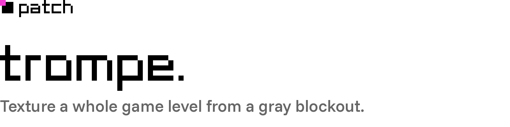
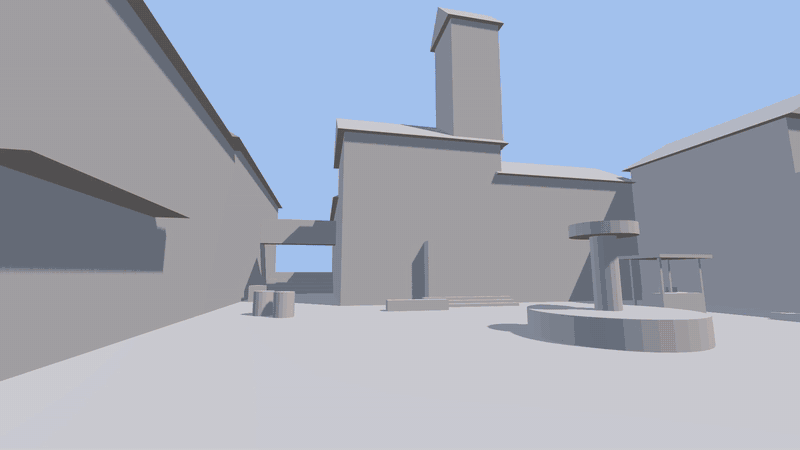

<picture>
  <source media="(prefers-color-scheme: dark)" srcset="docs/readme/header-evening.png">
  
</picture>

<br><br>



**@patch_gg** · village blockout + FLUX 3 Klein + Fibo 2 · 128 views on fal, $4.44, 26 minutes, one view at a time.

**Good for realistic buildings seen from a few metres or more:** third-person and top-down games, trailers, big backdrops, and a first look at a level. **Not for stylised looks:** it's a photo painter, so it adds grime and uneven colour. **Not for the ground at a first-person player's feet:** that blurs, because the whole level shares one texture.

trompe plans cameras where a player can stand, has an image model paint what each one sees, projects every painting
back onto the level and bakes one texture. It paints under overcast light, so the texture comes out as albedo and your
engine lights it with real shadows. Planning, projection and baking run in your browser on your GPU; the image models
run on [fal](https://fal.ai).

[Demo video, 42 s](video/trompe_demo_web.mp4) · [Before and after](video/before_after.jpg) ·
[Baked shadows vs real light](video/shadows_before_after.jpg) · [What the prompts fixed](video/prompt_fix.jpg)

## Quick start

```bash
npm install
npx playwright install chromium               # for the headless scripts below
export FAL_KEY=your-fal-key                   # used by the dev server's fal proxy
npm run dev                                   # http://localhost:5178
```

To use it:
1. Pick a sample level (Village, Courtyard, Hall) or drop in your own `.glb`. It needs UVs and Y up.
2. Describe the look you want, as materials ("weathered limestone and ochre plaster walls, terracotta roofs"). Don't name objects: anything named here, like a fountain or a market stall, gets painted onto walls.
3. Press **Plan cameras**, then **Texture level**.
4. Download the textured `.glb` or the texture.

If you leave the fal key field empty, the dev server adds `FAL_KEY` server-side and the browser never sees it. A key typed into the field is kept in that browser and sent straight to fal.

Headless, from the command line, the run is saved to `runs/<id>/`:

```bash
node scripts/texture.mjs --level samples/village.glb --id village --views 90 --spacing 3.5 --aerial 8 --roofs 24 --holes 12 \
  --atlas 8192 --style "a sunlit Mediterranean hill village: weathered limestone and ochre plaster walls, ..."
```

Add `--plan-only` to get a free quote first: it picks the cameras in about a second, calls no model and prints the number of views. Each view costs 1¢ to 4¢ and takes about 10 seconds. A run is saved only when it finishes, so a crash loses what it has paid for.

On Windows the script runs through ANGLE's D3D11 backend (`TROMPE_ANGLE` picks another). `TROMPE_CHROME` points it at another Chromium or Chrome if Playwright's own isn't installed.

To try prompt or model changes cheaply before a full run, `scripts/prompt-test.mjs` repaints chosen views of a saved run, with the texture rebuilt up to just before each one. It can also paint roof passes on top of the finished run, and it saves every image to `runs/<run>-ab/<tag>/`. `--dry` writes the prompts and inputs without calling any model.

To fill whatever a saved run still misses, `--resume <id>` plans views only where the texture is missing or poor and paints on top, in place. For example: `node scripts/texture.mjs --level samples/village.glb --resume village --views 30 --aerial 8 --atlas 8192`. `--parallel 6` paints non-overlapping views at the same time, which is faster but leaves visible seams where they meet.

On WSL2, `scripts/browser.mjs` points headless Chromium's ANGLE at Mesa's D3D12 driver, so runs use the real GPU instead of SwiftShader.

## How it works

| Step | Where | What |
|---|---|---|
| Plan | `src/core/planner.ts` | Sample walkable floors at eye height. Drop spots inside solids or out in the open (rooftops). Join spots a player can walk between (following the floor, so stairs count) and keep the play areas. Render cheap probes from 8 headings per spot, then pick cameras greedily until most reachable surface is captured well. Each camera is ordered to overlap what's already painted. Roofs get their own close, drone-style cameras (`--roofs`, 15 m out, 50° down, facing each slope), chosen the same way over roof surfaces only. Then `--aerial` cameras pick up what's left, with their own budget: a high ring looks down at the tops of props and the ground behind them, and a low ring outside the level faces the outer walls. Paint order: players' views, then roofs, then the rings. Last, a hole pass (`--holes`) looks for texels nothing has painted (ground hidden behind props from eye height, tops of props). It renders candidate cameras 5 m above where players stand, plus the high ring, and picks them by how many unpainted pixels each actually sees. Those views paint only the holes. |
| See | `src/core/clay.ts`, `views.ts` | Lit gray render per camera (sky light, a soft key light, screen-space AO), plus per-pixel position, normal and UV buffers. The "state" image is the clay render with already-painted texture composited in. By default the clay is lit like an overcast day, with no cast shadows, and the prompts ask for soft overcast light. That's why photogrammetry is shot under cloud: the texture comes out close to albedo. `--lighting outdoor` paints under a sun and bakes its shadows in. It looks photographic from that one sun, but each view paints the shadows a little differently, and they can't be relit. |
| Prompt | `src/core/semantics.ts`, `src/providers/models.ts` | Each view's prompt is built from the level's part names (glTF material names, else mesh names). It lists the parts in the area to paint with rough positions ("house walls (left), stone stairs (bottom)"). Flat details such as windows, doors and stonework are allowed, but nothing may stick out or be added (awnings, stalls, signs, lamps and so on) unless the level models it. The look is materials only. Roof views get a roof-tile prompt, a mask covering only the roofs, and project nothing else. |
| Paint | `src/providers/` | The first view, and any view that's over 75% unpainted, goes to FLUX 3 Klein ($0.009). It keeps the geometry far better than Fibo on blank views. Everything else is a masked fill with Fibo 2 Edit ($0.04), and so is every roof view. Views with under 3% unpainted are skipped. Views run one at a time, so each sees everything painted before it. |
| Paste | `src/core/composite.ts` | Known pixels are kept exactly. The new image's colours are shifted by how far the model drifted on the known pixels along the seam (a push-pull fill of that difference, fading over ~120 px), then it fades in over 10 px. Any part of the area the model hands back unchanged (still gray clay) is left out of the projection, so the gray never passes for paint and a later view or the hole pass gets another go at it. |
| Project | `src/core/atlas.ts` | A UV-space pass writes colour into each texel this camera sees better than whatever is stored. Quality is cos(angle)/distance, and pixels within 6 px of a silhouette count at 0.3x, so a better view replaces them. Texels captured at under 0.4x a later view's quality get regenerated. A view can be limited to some of its pixels (transparent, premultiplied); roof passes use this. |
| Light | `src/core/viewer.ts` | The **Lit** display mode uses the texture as albedo under a real sun with shadow maps and sky light, so shadows always match the geometry. The sun sliders move them live. The **Textured** mode shows the texture as painted. |
| Bake | `src/core/export.ts` | The texture is the bake: gutters are padded, then it's exported as glTF. An overcast (albedo) texture goes on a lit material for the engine to light; a sun-painted one goes on an unlit material. |

The demo level (`samples/build_village.py`) names its parts through glTF materials ("house walls", "tiled roof", "stone stairs", "wooden barrels", ...), which is what the prompts read. It also unwraps by importance: surfaces players walk past get 62% of the texture, roofs 14% and outer walls 6%. Levels without part names still work: roofs are found by slope and height, and prompts go without a parts list.

The AI sky backdrop averages sky pixels only from views whose model painted the whole frame (Klein). Masked fills leave the clay sky as it was.

## The demo

The village in the video is run `village-07`: 128 views, $4.44 and 26 minutes on fal, painted one view at a time under
overcast light. 88 views come from where players stand, 20 from over the roofs, 11 from around the outside and 9 fill
holes. It's shown lit by a real sun, which swings round in the last shot.

`src/demo.ts` and `scripts/capture.mjs` replay a saved run wave by wave and render the frames straight off the WebGL
canvas. `video/compose.py` lays them out in Patch's video style (`video/lightsdown.py`): the clip in a plain frame with
the pink patch on its corner, one caption line under it, the label beside it. `video/audio.py` mixes the score and UI
sounds, and `video/encode.sh` muxes the result. `docs/readme/make_art.py` draws this README's header and footer.

The layout uses Patch's brand kit, which isn't in this repo: Patch Pixel is Patch's own typeface. Put the kit at
`./brand-kit` (or point `PATCH_BRAND_KIT` at it) to rebuild the video or the README art.

## Tests

```bash
npm test          # unit tests for compositing and planner helpers
npm run build     # type check + production build
```

## Known limits (next up)

- **Resolution.** Views are 1024 px. Klein can paint 2048 px views for $0.014 and shows visibly more detail; Fibo works at about 1 megapixel either way. `--view-size 2048` works, but a full run then keeps about 8 GB of per-view images in the tab. Views need to stream to disk as they finish first.
- **Some outer walls stay gray.** Walls facing narrow gaps between buildings aren't seen well by any camera yet.
- **Misprojections.** Overhangs (like the arcade ceiling) can catch misprojected fragments, and gables sometimes get a patch of painted sky. Next is an automatic retouch pass: find seams and odd patches, then send masked fills over them.
- **Floor clutter from down-looking views.** Floor views make the models paint crates and debris onto the ground, so they're off (`downYaws: 0`). Floor views need their own prompt, or the normals check from the spike.
- **No local models yet.** fal only so far; a ComfyUI provider is next.
- **Albedo is approximate.** Overcast painting removes cast shadows, but the models still paint some soft shading and contact darkening. Dividing out the known clay shading, or a Marigold-style intrinsic decomposition, would get closer. Normal and roughness maps are planned too.
- **No UV unwrapping.** Levels must come with UVs; importance weighting only exists in the demo level's builder.

## License

Apache-2.0, see [LICENSE](LICENSE). The Patch name, mark, wordmark and Patch Pixel belong to Patch and aren't covered
by it. Funnel Sans and Red Hat Mono in `video/fonts/` are under the SIL Open Font License 1.1
([OFL-FunnelSans.txt](video/fonts/OFL-FunnelSans.txt), [OFL-RedHatMono.txt](video/fonts/OFL-RedHatMono.txt)).

The demo video's music isn't in the repo. To rebuild the video with a score, put a track at `video/audio/music.mp3`
and its downbeats in `video/audio/beats.json`; without one, `video/audio.py` mixes the UI sounds alone.

## Credits

Made by [Patch](https://patch.gg) ([@patch_gg](https://x.com/patch_gg)). Image models run on [fal](https://fal.ai):
FLUX 3 Klein by Black Forest Labs for first views, Fibo 2 Edit by Bria for fills and roofs (others are wired up in
`src/providers/models.ts`). Built on [three.js](https://threejs.org),
[three-mesh-bvh](https://github.com/gkjohnson/three-mesh-bvh), Vite and Playwright.

<br>

<picture>
  <source media="(prefers-color-scheme: dark)" srcset="docs/readme/footer-evening.png">
  
</picture>
